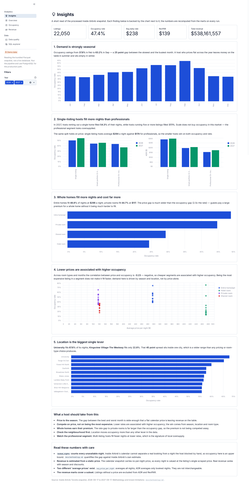
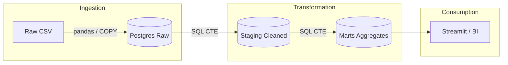

[](https://opensource.org/licenses/MIT)


# Inside Airbnb ETL

An end-to-end analytics project over the Inside Airbnb snapshot for **Toronto, Canada**: listings scraped 2026-09-16, calendar covering 2026-09-17 → 2027-09-17. A SQL ETL pipeline loads 22,050 listings and 8.0M calendar nights into PostgreSQL, and a Streamlit dashboard turns them into occupancy and revenue insights.

## TL;DR

**The question.** The project measures what drives occupancy in the Toronto short-term rental market, and what a host can act on.

**The five findings** (each is recomputed from the data and shown with its chart on the Insights page):

1. **Demand is strongly seasonal.** Occupancy runs from **37.8%** in February to **63.2%** in September, a 25-point swing across the year.
2. **Single-listing hosts beat professionals.** Hosts with one listing fill **54.3%** of nights at **$294** ADR; hosts with five or more fill **37.1%** at **$174**. Scale does not buy occupancy here.
3. **Whole homes earn a large premium.** Entire homes fill **48.8%** at **$296**/night; private rooms fill **44.7%** at **$117**/night. The price gap (2.5x) is far wider than the occupancy gap.
4. **Lower prices are associated with higher occupancy.** The price↔occupancy correlation is **−0.23** across room types and months: negative.
5. **Location is the biggest lever.** The best neighbourhood fills **67.6%** of nights, the worst **22.8%**: a 45-point spread inside one city.

**The caveats** are measured, not hand-waved, and each one is documented with its size in [`docs/methodology.md`](docs/methodology.md:1). The short version:

- **Occupancy is an upper bound.** "Unavailable" is not "booked": hosts also block nights by hand. This pipeline reports 47.4%; Inside Airbnb's own estimate is 19.9%, and the two correlate at −0.02. Treat 47.4% as a ceiling.
- **Revenue is estimated from a static price.** The calendar snapshot has no per-night price, so every night is valued at the listing's single scraped price. Read `total_revenue` as an upper-bound estimate.
- **Two "average prices" coexist.** `avg_price_per_night` (all nights) and ADR (booked nights only) are different quantities and are not interchangeable.
- **The staging layer keeps stale rows.** 15,382 listings from earlier snapshots survive the upsert; they never reach a metric but they inflate any direct read of `staging.listings`.
- **The revenue marts cover a subset.** 7,634 listings carry no price and are excluded from ADR/RevPAR.

The Data quality page surfaces every one of these counts on each run.

## Dashboard

<picture>
  <source media="(prefers-color-scheme: dark)" srcset="docs/screenshots/dark/full/insights.png">
  <source media="(prefers-color-scheme: light)" srcset="docs/screenshots/light/full/insights.png">
  
</picture>

Six pages over the `marts` schema: Insights, Overview, Occupancy, Revenue, Data quality and SQL explorer. Screenshots of every page in both themes, the page-by-page contents and the two data sources are in [`docs/dashboard.md`](docs/dashboard.md:1).

## Architecture



### Data layers

| Layer | Schema | Tables | Purpose |
| ------- | -------- | -------- | --------- |
| **Raw** | `raw` | `listings`, `calendar` | 1:1 copy of CSV with minimal validation |
| **Staging** | `staging` | `listings`, `calendar` | Cleaned, typed data with derived time dimensions |
| **Marts** | `marts` | `occupancy_by_listing`, `occupancy_by_neighbourhood`, `occupancy_by_room_type`, `revenue_by_listing` | Pre-aggregated metrics for analytics |

### Key metrics

- **Occupancy Rate** = `booked_nights / total_nights` (a fraction in `[0, 1]`). `booked_nights` counts every night flagged unavailable, so this is an upper bound; see [`docs/methodology.md`](docs/methodology.md:1).
- **ADR (Average Daily Rate)** = Average price per booked night
- **RevPAR (Revenue Per Available Room)** = Total revenue / available nights

Revenue is estimated from each listing's single scraped price (the calendar snapshot carries no per-night price), so ADR, RevPAR and total revenue are estimates over the priced subset of listings. Column-level detail is in [`docs/schema.md`](docs/schema.md:1).

## Quickstart

The Toronto snapshot ships with the repository as Parquet, so a fresh clone runs end to end with no download step and no network access.

Dashboard without a database:

```bash
uv sync
streamlit run src/dashboard/app.py
```

Full pipeline through Docker:

```bash
docker-compose -f docker/docker-compose.yml up --build
```

The dashboard waits for the pipeline to finish, then serves on `http://localhost:8501`. Prerequisites, the local-development path, the bundled dataset and switching to another city are in [`docs/setup.md`](docs/setup.md:1).

## Project structure

```bash
inside-airbnb-etl/
├── configs/          # config.yaml and the .env template
├── data/             # Bundled Toronto snapshot (raw/) and the demo layer (demo/)
├── docs/             # Methodology, setup, schema, dashboard, queries, performance
├── scripts/          # Artifact rebuild, demo-layer build, dashboard screenshots
├── docker/           # Dockerfile and docker-compose.yml
├── sql/              # 01..05 layer DDL/transforms, plus queries/ for the dashboard
├── src/
│   ├── config.py     # Typed configuration
│   ├── models/       # Listing and calendar Pydantic models
│   ├── extract/      # Chunked CSV/Parquet extraction and vectorized normalization
│   ├── load/         # PostgreSQL COPY-based bulk loading
│   ├── dashboard/    # Streamlit app, backend abstraction and pages
│   └── pipeline.py   # ETL orchestration
└── tests/            # Models, normalization, extraction, config, dashboard, backend
```

## Documentation

| Document | Contents |
| -------- | -------- |
| [`docs/methodology.md`](docs/methodology.md:1) | Metric definitions and the measured size of every limitation |
| [`docs/setup.md`](docs/setup.md:1) | Dashboard without a database, Docker, local development, bundled dataset |
| [`docs/configuration.md`](docs/configuration.md:1) | `config.yaml`, the precedence chain and environment overrides |
| [`docs/schema.md`](docs/schema.md:1) | Raw, staging and marts tables, key metrics, data sources |
| [`docs/dashboard.md`](docs/dashboard.md:1) | Pages, screenshots, the two data sources and the demo layer |
| [`docs/queries.md`](docs/queries.md:1) | The reusable SQL files and ad-hoc examples |
| [`docs/performance.md`](docs/performance.md:1) | Load tuning and the measured speed-up |
| [`docs/development.md`](docs/development.md:1) | Tests, linting, running the pipeline, adding transformations |

## License

MIT
