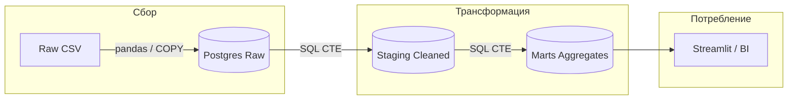

# Airbnb Occupancy Analytics Pipeline

ETL pipeline for processing Airbnb listings and calendar data to calculate occupancy rates and revenue metrics.

## Architecture



### Performance

The raw load is tuned for large inputs (hundreds of MB of calendar rows):

- **Vectorized normalization** (`src/extract/normalize.py`) cleans each chunk
  with pandas column operations instead of constructing one Pydantic model per
  row. The field groups it uses are shared with the models, so the two paths
  cannot drift apart.
- **`COPY ... FROM STDIN`** streams each batch into a temp table that is merged
  into the raw table with a single `INSERT ... ON CONFLICT`, replacing the
  per-row upsert.
- **Read/load split**: CSVs are read in `chunk_size` blocks and handed to the
  loader in `batch_size` slices, so pandas does few large passes while each
  COPY buffer stays bounded.
- **Connection pooling** keeps one connection alive across batches.
- Set `pipeline.use_copy: false` to fall back to the row-wise `INSERT` path if
  the database user lacks `COPY` privileges.

Measured on the bundled dataset (8.0M calendar rows, 330 MB of CSV):

| Stage | Before | After | Speed-up |
|-------|--------|-------|----------|
| Normalize + validate (rows/s) | ~176k | ~512k | ~2.9x |
| Load 200k calendar rows | 47.0 s (4.3k rows/s) | 4.5 s (44.2k rows/s) | ~10.4x |

### Data Layers

| Layer | Schema | Tables | Purpose |
| ------- | -------- | -------- | --------- |
| **Raw** | `raw` | `listings`, `calendar` | 1:1 copy of CSV with minimal validation |
| **Staging** | `staging` | `listings`, `calendar` | Cleaned, typed data with derived time dimensions |
| **Marts** | `marts` | `occupancy_by_listing`, `occupancy_by_neighbourhood`, `occupancy_by_room_type`, `revenue_by_listing` | Pre-aggregated metrics for analytics |

### Key Metrics

- **Occupancy Rate** = `booked_nights / total_nights` (a fraction in `[0, 1]`)
- **ADR (Average Daily Rate)** = Average price per booked night
- **RevPAR (Revenue Per Available Room)** = Total revenue / available nights

Calculated at multiple granularities:

- By listing
- By neighbourhood
- By room type
- By time period (year, month, week, quarter)

## Quick Start

The Toronto snapshot ships with the repository as Parquet
(`data/raw/listings.parquet`, `data/raw/calendar.parquet`, ~9.5 MB total), so a
fresh clone runs end to end with **no download step and no network access**.

### Prerequisites

- Docker & Docker Compose
- Python 3.12 (for local development)

### Using Docker (Recommended)

```bash
# Start PostgreSQL, run the pipeline, then serve the dashboard on :8501
docker-compose -f docker/docker-compose.yml up --build
```

The `dashboard` service waits for the pipeline (`app`) to finish before it
starts, so `http://localhost:8501` is ready once the load completes. To run only
the ETL step, start the `app` service on its own:

```bash
docker-compose -f docker/docker-compose.yml up --build app
```

### Local Development

```bash
# 1. Install dependencies
pip install -e ".[dev]"

# 2. Start PostgreSQL
docker-compose -f docker/docker-compose.yml up -d postgres

# 3. Run pipeline (configs/config.yaml is used by default)
python -m src.pipeline

# 4. Explore the results in the dashboard
streamlit run src/dashboard/app.py

# Optional: override settings via .env
cp configs/.env.example .env
```

### Bundled dataset

The committed artifacts come from the Inside Airbnb snapshot for **Toronto,
Canada, 2026-09-16**
([source](https://insideairbnb.com/get-the-data)):

| File | Rows | Columns | Size |
| ------ | ------ | --------- | ------ |
| `data/raw/listings.parquet` | 22,050 | 90 (all CSV columns) | 7.4 MB |
| `data/raw/calendar.parquet` | 8,048,251 | 5 | 2.1 MB |

Parquet keeps the repository small: the same data as `csv.gz` is 31.7 MB, so the
committed form is ~3.3x lighter. The listings file keeps every column, so the
raw layer stays a 1:1 copy of the CSV.

To use another city or a newer snapshot, download the `csv.gz` files from
Inside Airbnb and rebuild the artifacts:

```bash
python scripts/csv_to_parquet.py
# or point it at explicit files
python scripts/csv_to_parquet.py --listings /tmp/listings.csv.gz --calendar /tmp/calendar.csv.gz
```

The same snapshot is also published on
[Kaggle](https://www.kaggle.com/datasets/vladimirkondratev/inside-airbnb-toronto-sep-2026/)
if you prefer downloading it from there. The extractor is chosen from the
configured extension, so pointing `data.listings_file` at a `.csv` / `.csv.gz`
file makes the pipeline read the original downloads directly.

## Configuration

Configuration lives in one typed object (`src.config.AppConfig`) built from
`configs/config.yaml` and optional environment overrides. Values are resolved
through an explicit precedence chain, highest priority first:

1. CLI / init arguments (`--config`, `AppConfig(..., database={...})`)
2. process environment variables
3. `.env` file
4. `configs/config.yaml` — the primary declarative file
5. defaults declared in the code

Unknown keys in `config.yaml` raise an error, so typos surface immediately
instead of being silently ignored. The config object is immutable once built.

### YAML Config (`configs/config.yaml`)

This is the file to edit. It is loaded by default, no flag needed.

```yaml
database:
  host: localhost
  port: 5432
  name: airbnb
  user: airbnb
  password: airbnb

data:
  data_path: ./data          # raw/ and processed/ are derived from this
  listings_file: listings.parquet   # .csv / .csv.gz also work
  calendar_file: calendar.parquet

pipeline:
  batch_size: 100000     # rows per COPY/INSERT batch
  chunk_size: 250000     # rows read per pandas pass
  validate_data: true
  skip_invalid_rows: false
  use_copy: true         # COPY FROM STDIN (false = row-wise INSERT fallback)

logging:
  level: INFO
```

### Environment Overrides (`.env`)

Optional. Use these to override `config.yaml` for CI, Docker or one-off runs
without editing the file. See `configs/.env.example` for the full list.

```bash
# Database (overrides database.*)
POSTGRES_HOST=localhost
POSTGRES_PORT=5432
POSTGRES_DB=airbnb
POSTGRES_USER=airbnb
POSTGRES_PASSWORD=airbnb

# Data root (overrides data.data_path)
DATA_PATH=./data

# Pipeline (overrides pipeline.*)
BATCH_SIZE=100000
CHUNK_SIZE=250000
VALIDATE_DATA=true
SKIP_INVALID_ROWS=false
USE_COPY=true

# Logging (overrides logging.level)
LOG_LEVEL=INFO
```

## Project Structure

```
airbnb-occupancy-pipeline/
├── configs/
│   ├── config.yaml          # Pipeline configuration
│   └── .env.example         # Environment variables template
├── data/
│   └── raw/                 # Bundled Toronto snapshot (Parquet, committed)
├── scripts/
│   └── csv_to_parquet.py    # Rebuild the artifacts from csv.gz downloads
├── docker/
│   ├── Dockerfile           # Application container
│   └── docker-compose.yml   # PostgreSQL + app services
├── sql/
│   ├── 01_ddl_raw.sql       # Raw layer schema
│   ├── 02_ddl_staging.sql   # Staging layer schema
│   ├── 03_ddl_marts.sql     # Marts layer schema
│   ├── 04_transform_staging.sql  # Raw → Staging
│   ├── 05_transform_marts.sql    # Staging → Marts
│   └── queries/             # Reusable analytics queries (dashboard + psql)
├── src/
│   ├── config.py            # Configuration management
│   ├── models/
│   │   ├── listing.py       # Listing Pydantic models
│   │   └── calendar.py      # Calendar Pydantic models
│   ├── extract/
│   │   ├── base.py          # Shared validation/batching logic
│   │   ├── csv_extractor.py # Chunked CSV extraction
│   │   ├── parquet_extractor.py # Row-group Parquet extraction
│   │   └── normalize.py     # Vectorized pandas normalization
│   ├── load/
│   │   └── postgres_loader.py # PostgreSQL COPY-based bulk loading
│   ├── dashboard/           # Streamlit dashboard over the marts schema
│   │   ├── app.py           # Dashboard entry point (st.navigation)
│   │   ├── data.py          # Cached DB access + granularity helpers
│   │   ├── ui.py            # Sidebar filters, formatting, Altair charts
│   │   └── app_pages/       # Overview, Occupancy, Revenue, SQL explorer
│   └── pipeline.py          # Main ETL orchestration
├── .streamlit/
│   └── config.toml          # Dashboard theme (light/dark)
├── tests/
│   ├── test_models.py       # Pydantic model tests
│   ├── test_extract.py      # Extraction tests
│   └── test_dashboard.py    # Dashboard data-helper tests
├── pyproject.toml           # Project metadata & dependencies
└── README.md
```

## Running the Pipeline

### Full Pipeline (Initial Load)

```bash
python -m src.pipeline
```

Or with custom config:

```bash
python -m src.pipeline --config configs/config.yaml
```

### Incremental Update

```bash
python -m src.pipeline --incremental
```

### Programmatic Usage

```python
from src.pipeline import ETLPipeline
from pathlib import Path

pipeline = ETLPipeline(Path("configs/config.yaml"))
pipeline.run_full_pipeline()
```

## Database Schema

### Raw Tables

```sql
raw.listings      -- All listing fields from CSV
raw.calendar      -- listing_id, date, available, min/max nights
```

### Staging Tables

```sql
staging.listings  -- Cleaned listings with typed fields
staging.calendar  -- Calendar with derived time dimensions (year, month, week, quarter, is_weekend)
```

### Marts Tables

```sql
marts.occupancy_by_listing         -- Occupancy per listing per time period
marts.occupancy_by_neighbourhood   -- Occupancy per neighbourhood per time period
marts.occupancy_by_room_type       -- Occupancy per room type per time period
marts.revenue_by_listing           -- ADR, RevPAR, total revenue per listing
marts.v_occupancy_summary          -- Overall summary view
```

## Querying Results

### Dashboard (Streamlit)

The repository ships a read-only Streamlit dashboard over the `marts` schema —
the fastest way to explore the processed data without writing SQL.

```bash
# Run the pipeline once, then start the dashboard
python -m src.pipeline
streamlit run src/dashboard/app.py
```

Pages:

| Page | Contents |
| ------ | ---------- |
| **Overview** | Portfolio KPIs (listings, occupancy, ADR, revenue), occupancy/ADR/RevPAR trends, seasonality by month, period detail table |
| **Occupancy** | Neighbourhood and room-type rankings, price-vs-occupancy scatter, neighbourhood leaderboard |
| **Revenue** | ADR/RevPAR trend, top listings by RevPAR, revenue KPIs |
| **SQL explorer** | Runs any saved query and shows the SQL for copy-paste into `psql` |

The dashboard reads the pre-aggregated marts only (never the raw layer), caches
query results with `@st.cache_data`, and keeps a single connection pool per
process via `@st.cache_resource`. The theme lives in
[`.streamlit/config.toml`](.streamlit/config.toml:1).

### Reusable SQL queries

Every dashboard view is backed by a plain SQL file in
[`sql/queries/`](sql/queries/overall_kpis.sql:1), so the same statements can be
run by hand:

| File | Purpose |
| ------ | --------- |
| [`overall_kpis.sql`](sql/queries/overall_kpis.sql:1) | Portfolio KPIs per period (occupancy + revenue joined on granularity) |
| [`occupancy_by_neighbourhood.sql`](sql/queries/occupancy_by_neighbourhood.sql:1) | Occupancy and price per neighbourhood, all granularities |
| [`occupancy_by_room_type.sql`](sql/queries/occupancy_by_room_type.sql:1) | Occupancy and price per room type |
| [`occupancy_by_listing.sql`](sql/queries/occupancy_by_listing.sql:1) | Occupancy per listing |
| [`revenue_by_listing.sql`](sql/queries/revenue_by_listing.sql:1) | ADR, RevPAR, revenue per listing |
| [`top_listings_by_revpar.sql`](sql/queries/top_listings_by_revpar.sql:1) | Top listings by RevPAR per month (window ranking) |
| [`seasonality.sql`](sql/queries/seasonality.sql:1) | Occupancy collapsed by calendar month |
| [`neighbourhood_ranking.sql`](sql/queries/neighbourhood_ranking.sql:1) | Neighbourhood leaderboard per year |
| [`price_vs_occupancy.sql`](sql/queries/price_vs_occupancy.sql:1) | Price vs. occupancy by room type and month |

Run one directly:

```bash
psql -h localhost -U airbnb -d airbnb -f sql/queries/seasonality.sql
```

### Ad-hoc examples

Occupancy by neighbourhood (monthly):

```sql
SELECT
    neighbourhood_cleansed,
    year,
    month,
    total_listings,
    occupancy_rate,
    avg_price_per_night
FROM marts.occupancy_by_neighbourhood
WHERE month IS NOT NULL
ORDER BY year, month, occupancy_rate DESC;
```

Top listings by RevPAR:

```sql
SELECT
    listing_id,
    year,
    month,
    revenue_per_available_night AS revpar,
    avg_daily_rate AS adr,
    occupancy_rate
FROM marts.revenue_by_listing
WHERE month IS NOT NULL
ORDER BY revpar DESC
LIMIT 20;
```

Overall occupancy trend:

```sql
SELECT * FROM marts.v_occupancy_summary
ORDER BY year, month;
```

## Testing

The test and lint tooling lives in the ``dev`` extra, so install it first:

```bash
uv sync --extra dev
```

```bash
# Run all tests
pytest

# Run with coverage
pytest --cov=src --cov-report=html

# Run specific test file
pytest tests/test_models.py -v
```

## Development

### Code Quality

```bash
# Lint
ruff check src tests

# Format
ruff format src tests

# Type check
pyright
```

> **Note:** `pandas==3.1.0` ships without a `py.typed` marker, so the
> `pandas-stubs` package (installed with the `dev` extra) is required for
> accurate type checking of pandas code.

### Adding New Transformations

1. Add DDL to `sql/03_ddl_marts.sql` (if new table)
2. Add transformation logic to `sql/05_transform_marts.sql`
3. Run pipeline to test

## Data Sources

The repository ships one Inside Airbnb snapshot, committed as Parquet in
`data/raw/`:

- `listings.parquet` — Toronto listings, snapshot 2026-09-16, all 90 CSV columns
- `calendar.parquet` — availability calendar for the same snapshot

Source: [Inside Airbnb](https://insideairbnb.com/get-the-data) (Toronto,
Canada). A copy of the same snapshot is on
[Kaggle](https://www.kaggle.com/datasets/vladimirkondratev/inside-airbnb-toronto-sep-2026/).

The original `csv.gz` downloads are not committed. Rebuild the Parquet artifacts
with [`scripts/csv_to_parquet.py`](scripts/csv_to_parquet.py:1); the pipeline
reads whichever format `data.listings_file` / `data.calendar_file` point at.

## License

MIT
