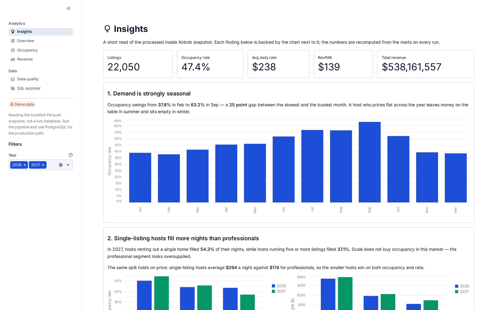
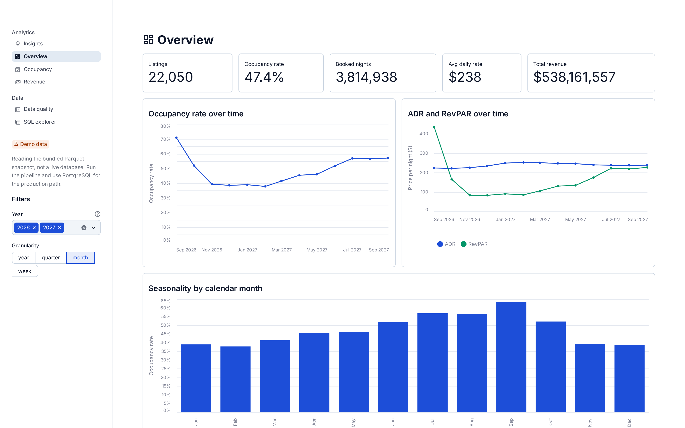

# Dashboard

The repository ships a read-only Streamlit dashboard over the `marts` schema, the fastest way to explore the processed data without writing SQL. Start it with the two commands in [Setup](setup.md).

## Pages

| Page | Contents |
| ------ | ---------- |
| **Insights** (default) | The five headline findings, each with its chart, plus recommendations and the caveats behind the numbers |
| **Overview** | Portfolio KPIs (listings, occupancy, ADR, revenue), occupancy/ADR/RevPAR trends, seasonality by month, period detail table |
| **Occupancy** | Neighbourhood and room-type rankings, price-vs-occupancy scatter, neighbourhood leaderboard |
| **Revenue** | ADR/RevPAR trend, top listings by RevPAR, revenue KPIs |
| **Data quality** | Layer counts and data quality checks (ghost listings, missing prices, dropped rows) with an explanation of each |
| **SQL explorer** | Runs any saved query and shows the SQL for copy-paste into `psql` (substitute any `:name` bind marker first) |

The dashboard reads the pre-aggregated marts only (never the raw layer), caches query results with `@st.cache_data`, and keeps a single connection per process via `@st.cache_resource`. The Data quality page reads the raw and staging layers on purpose: a quality check has to compare layers. The theme lives in [`.streamlit/config.toml`](../.streamlit/config.toml:1).

## Screenshots

Every page is captured in both themes at 2× device scale, in two frames:

- **hero**: `docs/screenshots/<theme>/<page>.png`, a 1600×1000 viewport shot with the Streamlit chrome (header, toolbar, "Running…" pill, deploy button, element toolbars) hidden. This is the portfolio frame.
- **full**: `docs/screenshots/<theme>/full/<page>.png`, the whole scrollable page, taken after unfolding the app shell so nothing is clipped.

**Insights**

<picture>
  <source media="(prefers-color-scheme: dark)" srcset="screenshots/dark/insights.png">
  <source media="(prefers-color-scheme: light)" srcset="screenshots/light/insights.png">
  
</picture>

**Overview**

<picture>
  <source media="(prefers-color-scheme: dark)" srcset="screenshots/dark/overview.png">
  <source media="(prefers-color-scheme: light)" srcset="screenshots/light/overview.png">
  
</picture>

The remaining pages (`occupancy`, `revenue`, `data-quality`, `sql-explorer`) follow the same `<theme>/<page>.png` (hero) and `<theme>/full/<page>.png` (full page) naming:

| Page | Light | Dark |
| ---- | ----- | ---- |
| Occupancy | [`light/occupancy.png`](screenshots/light/occupancy.png:1) | [`dark/occupancy.png`](screenshots/dark/occupancy.png:1) |
| Revenue | [`light/revenue.png`](screenshots/light/revenue.png:1) | [`dark/revenue.png`](screenshots/dark/revenue.png:1) |
| Data quality | [`light/data-quality.png`](screenshots/light/data-quality.png:1) | [`dark/data-quality.png`](screenshots/dark/data-quality.png:1) |
| SQL explorer | [`light/sql-explorer.png`](screenshots/light/sql-explorer.png:1) | [`dark/sql-explorer.png`](screenshots/dark/sql-explorer.png:1) |

The script writes full-page frames into `screenshots/light/full/` and `screenshots/dark/full/`; they are generated on demand and are not committed.

Regenerate the whole set with the app running:

```bash
pip install playwright && playwright install chromium
streamlit run src/dashboard/app.py --server.port 8501 --server.headless true &
python scripts/shoot_dashboard.py                                # hero + full, light + dark
python scripts/shoot_dashboard.py --mode hero --only overview    # one page, one frame
```

[`scripts/shoot_dashboard.py`](../scripts/shoot_dashboard.py:1) drives a headless Chromium over the app. It applies the theme the same way the UI does (a fresh browser context plus the per-page `stActiveTheme-<pathname>-v2` entry in `localStorage`) and verifies that the rendered background luminance really matches the requested theme, hides the Streamlit chrome, scrolls through the page so every chart mounts, then writes the hero and full frames. `--only` limits a run to a comma-separated list of page slugs and `--keep-chrome` keeps the header for debugging. It talks to whatever engine is serving the dashboard, so the PostgreSQL and demo-layer paths produce the same images.

## Two data sources, one set of queries

The dashboard can be served by either engine, chosen by `dashboard.source`:

| Source | When | What it reads |
| ------ | ---- | ------------- |
| `postgres` | The pipeline has populated the database | `marts` schema in PostgreSQL |
| `duckdb` | No database available | The committed Parquet demo layer |
| `auto` (default) | Always | PostgreSQL if reachable, otherwise the demo layer |

The engine is the only thing that varies. Both paths execute the same [`sql/queries/*.sql`](../sql/queries/overall_kpis.sql:1) files through the `QueryBackend` abstraction in [`src/dashboard/backend.py`](../src/dashboard/backend.py:1), so no aggregation is reimplemented in Python. The two dialects differ in exactly two constructs, `UNIQUE NULLS NOT DISTINCT` and the `:name` bind markers, and [`to_duckdb_sql()`](../src/dashboard/backend.py:129) translates them.

The demo layer is built by [`scripts/build_demo_marts.py`](../scripts/build_demo_marts.py:1), which runs the *entire* pipeline (raw load, staging, marts) inside a throwaway DuckDB database using the same SQL scripts and the same vectorized normalizers, then exports the result as Parquet. Before exporting, it asserts the figures match the ones in [`methodology.md`](methodology.md:1):

| Figure | Expected |
| ------ | -------- |
| Calendar nights | 8,048,251 |
| Booked nights | 3,814,938 |
| Occupancy rate | 47.4% |
| Estimated revenue | $538,161,557 |

A mismatch fails the build, so the demo layer cannot silently drift from the documented numbers. The same check runs as a test in [`tests/test_backend.py`](../tests/test_backend.py:1).

The assumptions behind every metric, with the measured size of each error, are written up in [`methodology.md`](methodology.md:1).

## Related

- [Queries](queries.md) for the SQL behind every view
- [Setup](setup.md) for starting the dashboard
