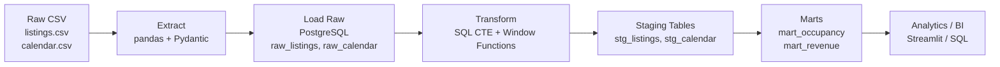

# Архитектура пайплайна Airbnb Occupancy Analytics

## Общая схема



## Слои данных

| Слой | Таблицы | Назначение |
| ------ | --------- | ------------ |
| **Raw** | `raw_listings`, `raw_calendar` | 1:1 копия CSV, минимальная валидация |
| **Staging** | `stg_listings`, `stg_calendar` | Очистка типов, дедупликация, enrichment |
| **Marts** | `mart_occupancy`, `mart_revenue` | Агрегаты для аналитики (occupancy rate по листингам/районам/времени) |

## Технологический стек

- **Python**: pandas (extract), pydantic (валидация), SQLAlchemy (ORM/load)
- **SQL**: PostgreSQL, чистые SQL-скрипты с CTE и оконными функциями
- **Инфраструктура**: Docker + docker-compose (PostgreSQL + app)
- **Тестирование**: pytest
- **Конфигурация**: YAML + .env

## Ключевые метрики (MVP)

1. **Occupancy Rate** = занятые ночи / доступные ночи
   - По листингам (listing_id)
   - По районам (neighbourhood_cleansed)
   - По времени (неделя/месяц/квартал/год)
2. **Доступные ночи** = календарь где available='t'
3. **Занятые ночи** = календарь где available='f'

## Структура проекта

```bash
airbnb-occupancy-pipeline/
├── configs/
│   ├── config.yaml          # Пути, параметры БД
│   └── .env.example         # Шаблон переменных окружения
├── docker/
│   ├── Dockerfile           # Образ приложения
│   └── docker-compose.yml   # PostgreSQL + app
├── sql/
│   ├── 01_ddl_raw.sql       # Схема raw слоя
│   ├── 02_ddl_staging.sql   # Схема staging слоя
│   ├── 03_ddl_marts.sql     # Схема marts слоя
│   ├── 04_transform_staging.sql  # Raw -> Staging
│   └── 05_transform_marts.sql    # Staging -> Marts (occupancy)
├── src/
│   ├── __init__.py
│   ├── config.py            # Загрузка конфигурации
│   ├── models/
│   │   ├── __init__.py
│   │   ├── listing.py       # Pydantic модель listings.csv
│   │   └── calendar.py      # Pydantic модель calendar.csv
│   ├── extract/
│   │   ├── __init__.py
│   │   └── csv_extractor.py # Чтение CSV с pandas
│   ├── load/
│   │   ├── __init__.py
│   │   └── postgres_loader.py # Загрузка в PostgreSQL + запуск SQL-скриптов (DDL/transform)
│   └── pipeline.py          # Оркестрация ETL
├── tests/
│   ├── __init__.py
│   ├── test_models.py       # Тесты Pydantic моделей
│   ├── test_extract.py      # Тесты извлечения
│   └── test_transform.sql   # SQL-тесты трансформаций
├── pyproject.toml           # Зависимости и настройки проекта
├── README.md                # Документация
└── .gitignore
